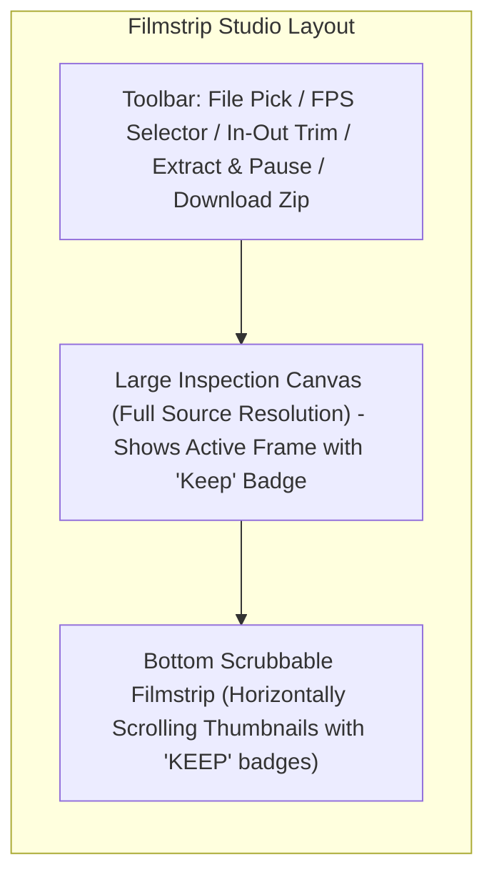

# Video Frame Extractor - Plan

## Goal Capsule

- **Objective:** Enable users to locally extract constituent frames from MP4 video clips, quickly review and compare adjacent frames in a dedicated filmstrip studio, and export selected favorites as a single `.zip` file without command-line tools or disk clutter.
- **Means:** Progressive Stream Studio single-file HTML tool with offscreen canvas extraction, keyboard-driven filmstrip comparison, and zero-dependency in-memory zip packaging.
- **Product Authority:** Standalone single-file HTML tool residing in `video-frame-extractor/index.html` within the tools collection, linked from root `index.html`.
- **Open Blockers:** None.

---

## Product Contract

> Product Contract unchanged.

### Summary

A standalone, zero-dependency single-file HTML tool that loads an MP4 video (optimized for 30s–4m clips) and progressively extracts still frames at a configurable rate (1–10+ fps or all frames) with optional in/out trim points. Users can inspect and compare frames in real time using a Filmstrip Studio layout with keyboard navigation (arrow keys to flip, spacebar to select) before downloading all kept frames as a single `.zip` archive.

### Problem Frame

Extracting high-quality still frames from short videos (such as Instagram clips) currently relies on command-line ffmpeg scripts (`ffmpeg -i $INPUT_FILE -r 3 -f image2 -q:v 2 "$OUTPUT_PATTERN-%03d.jpeg"`) paired with manual Finder browsing. This workflow introduces three key frictions: upfront guesswork when choosing frame rate, disk clutter from hundreds of discarded JPEG files, and clumsy micro-comparison in Finder when trying to catch subtle facial expressions or split-second action moments. A dedicated browser tool eliminates file clutter by keeping extraction in memory until the user chooses which frames to keep.

### Key Decisions

- **Progressive Stream Studio workflow** (session-settled: user-directed — chosen over Two-Step Wizard or Hybrid Burst: stream frames into the filmstrip live so user can inspect and select immediately while extraction continues). Governs R5, R6.
- **Filmstrip Studio layout** (session-settled: user-directed — chosen over Dense Grid + Quick Look, Side-by-Side Split, or Mix: persistent large inspection canvas on top with scrubbable thumbnail strip below, flipbook style without modals). Governs R7, R8.
- **Single .zip archive packaging** (session-settled: user-directed — chosen over loose individual files or both: one clean download without browser multi-download permission prompts). Governs R12, R13.
- **Configurable extraction rate with in/out trim markers** (session-settled: user-directed — chosen over every-frame extraction or fixed intervals: allows 1–10+ fps or all frames with optional trim points). Governs R3, R4.
- **Dual-tier image representation**: Generate lightweight downscaled thumbnails for the filmstrip while preserving full-resolution frames for the inspection viewport and export to avoid browser memory bloat on multi-minute clips. Governs R5, R7, R13.
- **Zero external dependencies**: Standard HTML5 Video and Canvas APIs, native browser event handling, and a minimal pure-JavaScript ZIP binary builder inlined directly into a single `index.html` file. Governs R1, R12.

### Visualizations



### Requirements

**Video Ingestion & Configuration**
- R1. The tool must run entirely client-side as a single standalone HTML file (`video-frame-extractor/index.html`) without any external server or network dependencies.
- R2. The user must be able to load an MP4 video file via drag-and-drop or file picker, immediately initializing video metadata (dimensions, duration, preview).
- R3. The user must be able to set an optional start (In) and end (Out) trim point using scrubber handles or timestamp inputs to limit extraction to a specific sub-clip.
- R4. The user must be able to select an extraction frame rate via presets (e.g. 1 fps, 3 fps, 6 fps, 12 fps, or all frames) and view an estimated total frame count before starting.

**Frame Extraction & Streaming**
- R5. When extraction starts, frames must extract progressively and stream into the filmstrip immediately without blocking the browser UI or requiring extraction to finish before interaction begins.
- R6. The user must be able to pause or stop extraction at any time, retaining all frames already extracted for inspection and selection.

**Gallery & Comparison (Filmstrip Studio)**
- R7. The interface must feature a Filmstrip Studio layout consisting of a large inspection viewport on top displaying the active frame at source resolution, and a horizontally scrolling filmstrip of thumbnails along the bottom.
- R8. Scrubbing or arrowing (Left/Right) through the filmstrip must update the large inspection canvas instantaneously to create a flipbook-style comparison effect.
- R9. The user must be able to toggle the "Keep" (selected) state of the active frame using the Spacebar, Enter key, or an on-canvas button, visibly badging kept frames in the filmstrip.
- R10. The filmstrip must automatically scroll to keep the active frame visible as the user navigates with keyboard arrow keys.
- R11. Bulk selection controls (Select All, Deselect All, Invert Selection) must be provided in the toolbar.

**Export & Packaging**
- R12. The tool must provide a "Download Selected (.zip)" action that packages all currently kept frames into a single standard `.zip` file using client-side JavaScript with zero third-party dependencies.
- R13. Files inside the `.zip` archive must be high-quality JPEGs named with a sequential index and timestamp relative to the source clip (e.g., `[clip-name]-frame-001-00m04s33.jpg`).
- R14. If no frames are selected, the download action must be disabled and guide the user to select at least one frame.

### Key Flows

- F1. Progressive Ingestion to Rapid Triage
  - **Trigger:** User drops an MP4 file onto the upload zone.
  - **Actors:** User
  - **Steps:** Video preview and duration load; user sets FPS to 6 fps and trims to 00:15–00:45; user clicks "Start Extraction"; frames immediately begin streaming into the bottom filmstrip; user hits Left/Right arrows to scrub through extracted frames, pressing Space to mark favorites while remaining frames continue extracting.
  - **Outcome:** Selected frames are marked with "KEEP" badges with no lag or waiting.
  - **Covered by:** R2, R3, R4, R5, R8, R9

- F2. Archive Download
  - **Trigger:** User finishes reviewing and clicks "Download Selected (.zip)".
  - **Actors:** User
  - **Steps:** The tool verifies selected frames count; generates uncompressed PKZIP binary structures in memory containing the high-res JPEG blobs; triggers browser download of `[clip-name]-frames.zip`.
  - **Outcome:** A single ZIP file lands in the user's Downloads folder without multi-file security prompts.
  - **Covered by:** R12, R13, R14

### Acceptance Examples

- AE1. Progressive inspection during active extraction
  - **Covers R5, R6, R8, R9.**
  - **Given:** A 2-minute MP4 video undergoing extraction at 3 fps (360 total frames target).
  - **When:** 30 frames have been extracted so far while the remaining 330 are still processing.
  - **Then:** The filmstrip displays the first 30 frames immediately; the user can arrow through frames 1–30 and toggle Space to keep frame #14; the extraction continues unhindered in the background.

- AE2. Zero selection export safeguard
  - **Covers R14.**
  - **Given:** 120 frames extracted in the filmstrip with 0 frames marked as kept.
  - **When:** The user views the export controls.
  - **Then:** The "Download Selected (.zip)" button is disabled with text reading "0 frames selected".

- AE3. Keyboard-driven flipbook comparison
  - **Covers R8, R9, R10.**
  - **Given:** Active frame is #42 in the filmstrip.
  - **When:** The user presses Right Arrow twice followed by Spacebar.
  - **Then:** Frame #43 then #44 are immediately rendered in the top inspection canvas; the filmstrip smoothly centers on #44; frame #44 is toggled to "KEEP" and shows a prominent green badge.

### Scope Boundaries

- **Deferred for later:**
  - Direct video trimming or re-encoding of the video itself.
  - PNG lossless export option (JPEG high-quality is v1 scope).
  - WebCodecs / hardware acceleration beyond standard HTML5 Video seek.
  - Audio extraction or waveform display.
- **Outside this product's identity:**
  - Cloud hosting or server-side conversion pipelines (this is strictly a local-first browser tool).
  - Social network sharing or direct Instagram posting.
  - Full non-linear video editing (timeline cuts, transitions, effects).

### Dependencies / Assumptions

- **Dependencies:** Modern web browser supporting HTML5 Video (`<video>` with MP4/H.264 playback) and 2D Canvas (`CanvasRenderingContext2D.drawImage`).
- **Assumptions:** Input files are standard MP4 containers compatible with browser native decoding (H.264 video codec). Videos are typically under 4 minutes, allowing comfortable in-memory storage of extracted frames.

---

## Planning Contract

### Technical Design

The implementation creates `video-frame-extractor/index.html` as a single-file application adhering to repo conventions defined in `CLAUDE.md`.

1. **Architecture & Styling**:
   - Standard HTML5 layout: `<style>` containing responsive CSS and CSS custom properties (`--bg`, `--fg`, `--muted`, `--card`, `--border`, `--accent`, `--ok`, `--danger`, etc.), supporting light and dark color schemes.
   - Self-contained ES module script (`<script type="module">`).
   - Root catalog integration: append tool entry to `/index.html` list.

2. **Video & Canvas Engine**:
   - Native `<video>` element loaded via `URL.createObjectURL(file)`.
   - Hidden offscreen `<canvas>` for sampling frames at source dimensions.
   - Frame extraction loop: sequential `video.currentTime = t` steps driven by `seeked` event callbacks.
   - Dual-tier capture:
     - Filmstrip thumbnail: downscaled (e.g. 160px width) rendered to an offscreen canvas and stored as a lightweight thumbnail data URL / blob.
     - Source frame: full-resolution canvas extraction preserved as image blob or timestamp re-render for the main stage.

3. **Filmstrip Studio Interaction**:
   - Layout: top section contains the main stage with a large viewport (`` or `<canvas>`); bottom section contains a horizontally scrollable container with thumbnail elements.
   - Keyboard navigation via `window.addEventListener('keydown', ...)`:
     - `ArrowLeft` / `ArrowRight`: change selected index, update main preview immediately, call `scrollIntoView({ inline: 'center' })`.
     - `Space` / `Enter`: toggle selection of currently focused frame.
   - Responsive UI that stays responsive even during extraction.

4. **Zero-Dependency PKZIP Builder**:
   - An inlined pure JS function to construct standard uncompressed ZIP files (`Store`, compression method 0).
   - For each file: calculates CRC-32 (standard lookup table in JS), writes Local File Header (signature `0x04034b50`), file data, Central Directory entry (`0x02014b50`), and End of Central Directory (`0x06054b50`).
   - Outputs a `Blob` with MIME type `application/zip` and triggers programmatic download.

### Key Technical Decisions

- KTD1. **Pure JS uncompressed ZIP builder** (Governs R12): Rather than relying on external libraries like JSZip, build a minimal 60-line binary ZIP packer in vanilla JS using Uint8Array. Since JPEGs are already compressed, uncompressed storage (`compression method 0`) is fast, uses minimal memory, and maintains 0 external dependencies.
- KTD2. **Sequential seeked event extraction loop** (Governs R5, R6): Use `video.currentTime = t` wrapped in an async promise waiting on the `seeked` event. This guarantees accurate frame grabbing across all browsers without dropping frames.
- KTD3. **Downscaled thumbnails for filmstrip DOM** (Governs R5, R7): Generate 160px wide thumbnails for DOM elements in the filmstrip. This keeps DOM memory under 50 MB for 500+ frames and enables silky 60fps horizontal scrolling.
- KTD4. **Vanilla DOM with event delegation** (Governs R7, R8, R9): Use vanilla JavaScript with simple state management (`frames = [{ id, time, thumbUrl, blob, kept }]`, `currentIndex`), keeping rendering lightweight and deterministic.

---

## Implementation Units

### U1. Scaffolding & Root Listing
- **Goal:** Create the tool directory, standalone HTML template with responsive layout and theming, and link it from the repository root `index.html`.
- **Files:** `video-frame-extractor/index.html`, `index.html`
- **Patterns:** Mirror existing tools (`photo-album`, `sales-tax-estimator`), using system CSS variables (`--bg`, `--card`, `--accent`, etc.) and dark/light mode support.
- **Verification:** Load `http://localhost:8000/` and verify the link to Video Frame Extractor works; verify the layout renders cleanly.

### U2. Video Ingestion & Progressive Frame Extractor
- **Goal:** Allow users to pick or drop an MP4 file, preview duration and dimensions, configure start/end trim points and FPS (1, 3, 6, 12, or all), and extract frames progressively using an offscreen canvas.
- **Files:** `video-frame-extractor/index.html`
- **Patterns:** `URL.createObjectURL(file)`, `video.addEventListener('loadedmetadata')`, sequential `seeked` event async loop, downscaled thumbnail canvas capture.
- **Verification:** Load a sample MP4, verify duration and metadata display; click start extraction and confirm frames populate progressively in real-time.

### U3. Filmstrip Studio & Keyboard Navigation
- **Goal:** Implement the Filmstrip Studio layout featuring a large inspection viewport on top and a horizontal scrolling filmstrip on the bottom, with instant flipbook navigation and Spacebar selection.
- **Files:** `video-frame-extractor/index.html`
- **Patterns:** Keyboard listener for `ArrowLeft`/`ArrowRight` and `Space`/`Enter`, auto-scrolling with `scrollIntoView`, visually distinctive "KEEP" badges and selection counter.
- **Verification:** Verify arrow keys immediately update the main canvas without lag; verify Spacebar toggles frame selection badge; test Select All, Deselect All, Invert.

### U4. Zero-Dependency ZIP Builder & Export
- **Goal:** Implement the inlined PKZIP binary encoder to package all kept frames as high-quality JPEGs with timestamped filenames into a downloadable `.zip` file.
- **Files:** `video-frame-extractor/index.html`
- **Patterns:** Pure JS Uint8Array byte manipulation for Local File Headers, CRC-32 table, Central Directory, and EOCD; trigger download via `<a download="...">`.
- **Verification:** Select 5 frames, click "Download Selected (.zip)", verify the downloaded zip unpacks properly on macOS Archive Utility / Finder and contains all 5 JPEG files.

---

## Verification Contract

### Commands & Automated Checks
- Validate JavaScript syntax:
  ```bash
  node -e "import('fs').then(fs => { const html = fs.readFileSync('video-frame-extractor/index.html', 'utf8'); const js = html.match(/<script type=\"module\">([\s\S]*?)<\/script>/)[1]; eval('(async () => {' + js + '})'); console.log('Syntax valid'); })"
  ```
- Run local static HTTP server:
  ```bash
  python3 -m http.server 8000
  ```

### Manual Testing Scenarios
1. **Video Ingestion & Trim**: Drop an MP4 clip. Verify metadata loads. Adjust In/Out handles and FPS slider; verify frame count estimate updates.
2. **Progressive Extraction**: Start extraction. Verify thumbnails stream into the bottom strip immediately. Click "Pause/Stop" and verify extraction halts while retaining captured frames.
3. **Studio Comparison**: Use Arrow keys to navigate through adjacent frames. Confirm the top preview updates instantaneously like a flipbook. Press Space to toggle "Keep" on several frames.
4. **ZIP Download & Extraction**: Click "Download Selected (.zip)". Confirm a `.zip` file downloads. Open the zip file in Finder/Archive Utility and verify the extracted JPEGs are sharp and named correctly.
5. **Theme & Responsiveness**: Test in both Light and Dark mode, and test at desktop and laptop window widths.

---

## Definition of Done

- All requirements (R1 through R14) are fully satisfied in `video-frame-extractor/index.html`.
- The tool is added to the root `index.html` listing.
- The tool operates 100% client-side with zero external dependencies, CDN links, or server-side scripts.
- The downloaded `.zip` file unzips cleanly with native operating system archive tools.
